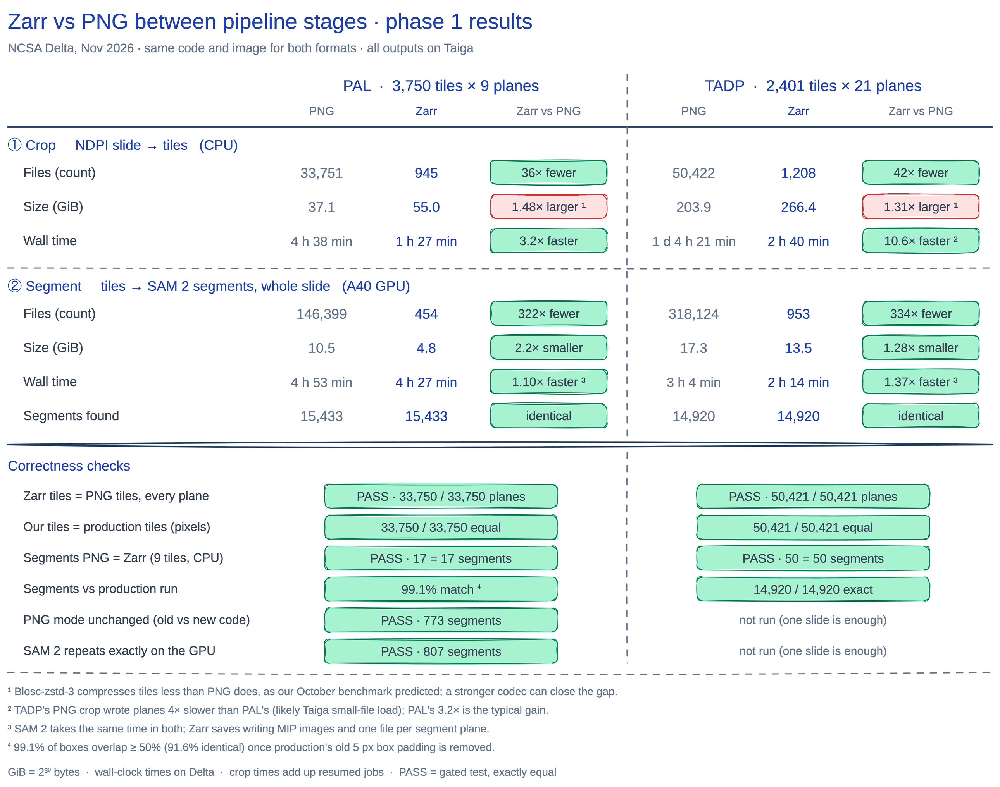

# Delta validation of Zarr mode (phase 1)

Tests of the Zarr mode of the tile cropper (`--tile_format zarr`, palyim-issues #117) and of the segmentation module
(`--input-format zarr`, `--output-format zarr`, palyim-issues #118) on NCSA Delta, on one PAL and one TADP slide.
They answer two questions: does Zarr mode give the same pixels and the same segments as PNG mode, and what does it
cost or save in files, bytes and time. Results are in [RESULTS.md](RESULTS.md).



## The tests

Gated tests must be exactly equal to pass. Reported tests compare against production output made by older images, so
they describe drift and never fail the job.

| Test | Stage | What is compared | Gated |
|---|---|---|---|
| G2 | cropper | Zarr tile store vs a PNG run of the same code and image: every plane of every tile, and the metadata | yes |
| G1 | cropper | New code in PNG mode vs the existing production tiles | reported |
| G0 | segmentation | Two GPU runs of the same code on 50 tiles: does SAM 2 repeat exactly? | yes |
| G1a | segmentation | Base code vs new code, both in PNG mode, 50 tiles: the PNG path is unchanged | yes |
| G3 | segmentation | PNG mode vs Zarr mode (PNG input and store input) on 9 tiles, two passes | yes |
| G1 | segmentation | New code in PNG mode, whole slide, vs the existing production segments | reported |
| Full slide | segmentation | Whole slide in Zarr mode from G2's store vs G1's PNG run: files, bytes, time, segments | reported |

## Layout

```
README.md, RESULTS.md         this file and the results
phase1-results.png            results figure (source in excalidraw/)
jobs/
  config.example.sh           every site path and SLURM account, in one place
  submit.sh                   sbatch wrapper: adds the account and the log folder from config.sh
  cropper/                    common.sh, build-sif, G1 and G2 templates, comparers and their tests
  segmentation/               common.sh, build-sif, G0, G1a, G1, G3 and full-slide templates, helpers
  make_phase1_table.py        builds the PNG vs Zarr table from the results copied back
  copy-back.rsync-filter      copies reports and logs back, never tiles or stores
```

The segmentation jobs also call `tests/golden/compare_outputs.py` from the segmentation repository's Zarr branch.

## Running the templates

The scripts are templates: they are the phase 1 job scripts with the site paths moved into `config.sh`. They have
not been run again in this form.

1. Clone both repositories on the cluster and switch them to the branches under test (`117-zarr-tile-store`,
   `118-zarr-segment-io`). For G1a add a worktree of the segmentation clone at the branch's base commit.
2. Copy `jobs/` next to them, `cp config.example.sh config.sh`, and replace every `CHANGEME`. `submit.sh` refuses to
   run while one is left.
3. Build each image from its branch's `Dockerfile` for `linux/amd64`, `docker save` it, copy the tar to `SIF_DIR` and
   convert it on a compute node: `./submit.sh cropper/build-sif.sbatch <tar>` and
   `./submit.sh segmentation/build-sif.sbatch <tar>`. The jobs run the checkout's code inside the image, so only a
   dependency change needs a new SIF.
4. Submit in this order; each step reads the outputs of the ones before it.

```bash
cd jobs
G2_KEEP_PNG=1 ./submit.sh cropper/g2-zarr-vs-png.sbatch            # array: task 0 TADP, task 1 PAL
./submit.sh cropper/g1-png-new-vs-production-tiles.sbatch
P=PAL1999_B2_sample100_slide1                                      # the default slide is the TADP one
SLIDE_NAME=$P GT_CSV= ./submit.sh segmentation/g0-gpu-variance.sbatch
SLIDE_NAME=$P GT_CSV= ./submit.sh segmentation/g1a-png-base-vs-new.sbatch
./submit.sh segmentation/g3-png-vs-zarr.sbatch
SLIDE_NAME=$P GT_CSV= ./submit.sh segmentation/g3-png-vs-zarr.sbatch
./submit.sh segmentation/g1-png-new-vs-production-outputs.sbatch
SLIDE_NAME=$P GT_CSV= ./submit.sh segmentation/g1-png-new-vs-production-outputs.sbatch
./submit.sh segmentation/full-slide-png-vs-zarr.sbatch             # after G1 of the same slide
SLIDE_NAME=$P GT_CSV= ./submit.sh segmentation/full-slide-png-vs-zarr.sbatch
```

Each job writes a folder under `$OUT_ROOT/<test>/<job id>/` with `env.txt` (commits, image hash, slide), the logs
and a one-line verdict in `verdict.txt` or `result.txt`. Settings pass through the environment
(`VAR=value ./submit.sh ...`), and sbatch options given to `submit.sh` override the `#SBATCH` lines.

5. Copy the reports back with `rsync -av --prune-empty-dirs --exclude-from=copy-back.rsync-filter` and run
   `python3 make_phase1_table.py <results folder>` for the table.

## Notes

- G2 with `G2_KEEP_PNG=1` leaves a full PNG tile tree per slide under `OUT_ROOT` (about 50,000 files for the TADP
  slide). The segmentation tests read it. Delete it once they are done.
- The partitions, CPU counts, memory and time limits in the `#SBATCH` lines are the ones used on Delta.
- `jobs/cropper/test_compare_scripts.py` tests the two cropper comparers and runs inside the cropper test image.
- `PALYIM_IO_SRC` in `config.sh` can put a palyim-io checkout ahead of the image's copy. Phase 1 used it for the
  0.1.1 fix; images with palyim-io 0.1.2 or newer do not need it.
