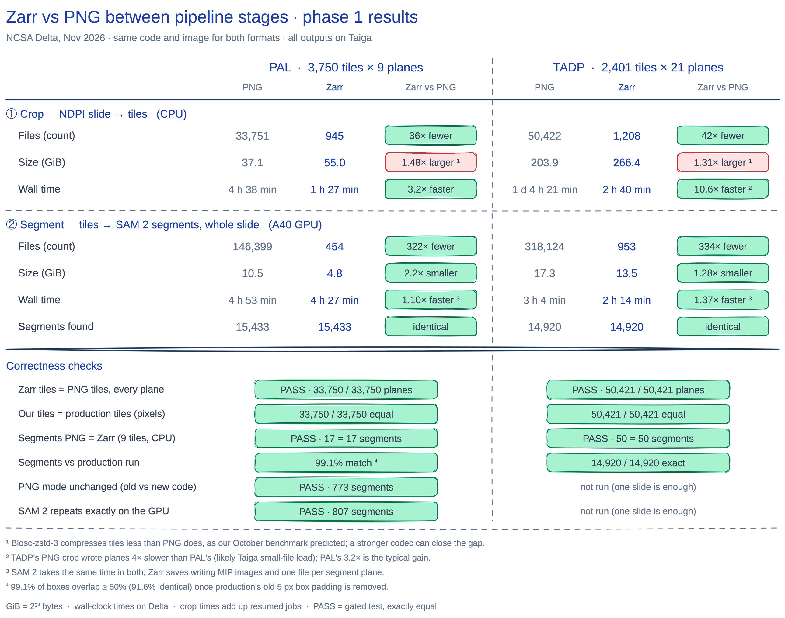

# Results: Zarr vs PNG on Delta (phase 1)

Run on NCSA Delta between 2026-11-05 and 2026-11-10. Zarr mode gives the same tile pixels and the same segments as
PNG mode on both slides, with 36 to 42 times fewer tile files and 322 to 334 times fewer segment files.

## Setup

| | |
|---|---|
| Slides | PAL `PAL1999_B2_sample100_slide1` (3,750 tiles × 9 planes) and TADP `54490_TADP1_232Q-2-69_L_2024_11_12_15_50_13` (2,401 tiles × 21 planes) |
| Tile cropper | `ndpi-tile-cropper-cli` at `486991f` (now branch `117-zarr-tile-store`), base `ae045e0` |
| Segmentation | `post-processing-cli-sam-2` at `7eb235d` (now branch `118-zarr-segment-io`), base `2a1d6b6`. The PAL full-slide PNG run used `f038fd5`, which differs only in the test comparer |
| palyim-io | 0.1.0 in the images; 0.1.1 from source for every segmentation run from 2026-11-09 on |
| Images | One image per stage, built from each branch's `Dockerfile`: Python 3.12.16, numpy 1.26.4, zarr 3.1.5; cropper with python-bioformats 4.0.7 and python-javabridge 4.0.3; segmentation with torch 2.3.1 and SAM 2 (`sam2_hiera_large`) |
| Tiling | `-s 2048 -l 256`; Zarr written in-process (`--store-writers 0`) |
| Segmentation flags | `-mip -s -a 3600 -b 84100 -ar 0.4 -p -nt 8`, plus `-g <ground truth> -mt` for TADP |
| Hardware | Cropper: 8 CPUs, 24 GB. Full-slide segmentation: one A40 GPU, 32 CPUs, 96 GB. All outputs on Taiga |

Both branches were later updated with the review fixes of the PRs they build on. These results are from the
commits above.

## PNG vs Zarr

| Slide | Stage | Format | Files | Bytes | Wall time | Segments | Zarr vs PNG |
|---|---|---|---|---|---|---|---|
| PAL | ① crop | PNG | 33,751 | 37.14 GiB | 4:38:09 | | |
| PAL | ① crop | Zarr | 945 | 55.04 GiB | 1:27:30 | | files ÷36, bytes ×1.48, time ×0.31 |
| PAL | ② segment | PNG | 146,399 | 10.50 GiB | 4:53:13 | 15,433 | |
| PAL | ② segment | Zarr | 454 | 4.79 GiB | 4:26:59 | 15,433 | files ÷322, bytes ×0.46, time ×0.91 |
| TADP | ① crop | PNG | 50,422 | 203.89 GiB | 28:20:40 | | |
| TADP | ① crop | Zarr | 1,208 | 266.40 GiB | 2:39:54 | | files ÷42, bytes ×1.31, time ×0.09 |
| TADP | ② segment | PNG | 318,124 | 17.34 GiB | 3:04:26 | 14,920 | |
| TADP | ② segment | Zarr | 953 | 13.50 GiB | 2:14:21 | 14,920 | files ÷334, bytes ×0.78, time ×0.73 |

Files and bytes are the tile tree or tile store for ①, and the output tree plus the CSV for ② (`du -sb`). Wall time
is the CLI process (GNU time). The crop times sum every job that cropped the slide, because a stopped crop resumes in
the next job: PAL took two jobs and TADP three. Stage ② PNG is the G1 run and stage ② Zarr reads the store from ①.

Where the segmentation time goes (h:mm:ss):

| Slide | Format | MIP | SAM 2 | Saving segments |
|---|---|---|---|---|
| PAL | PNG | 0:14:27 | 4:29:24 | 0:09:14 |
| PAL | Zarr | in the background, 0:00:00 waiting | 4:23:53 | 0:02:50 |
| TADP | PNG | 0:32:53 | 2:06:16 | 0:25:00 |
| TADP | Zarr | in the background, 0:00:00 waiting | 2:05:08 | 0:08:50 |

## Verdicts

| Test | Slide | Job | Result |
|---|---|---|---|
| G2 cropper, Zarr vs own PNG (gated) | PAL | 23605314 | PASS: 33,750 of 33,750 planes equal, metadata equal |
| G2 cropper, Zarr vs own PNG (gated) | TADP | 23605315 | PASS: 50,421 of 50,421 planes equal, metadata equal |
| G2 cropper, Zarr vs production tiles (reported) | PAL | 23605314 | 33,750 of 33,750 planes equal, metadata equal |
| G2 cropper, Zarr vs production tiles (reported) | TADP | 23605315 | 50,421 of 50,421 planes equal; two flags, see below |
| G1 cropper, new PNG vs production tiles (reported) | PAL | 23683112 | 33,750 of 33,750 planes equal in pixels and bytes, metadata equal |
| G0 segmentation, GPU repeatability (gated) | PAL | 23683110 | EQUAL: 807 = 807 segments on 50 tiles |
| G1a segmentation, base vs new code in PNG mode (gated) | PAL | 23683111 | EQUAL: 773 = 773 segments on 50 tiles |
| G3 segmentation, PNG vs Zarr (gated) | PAL | 23682406 | EQUAL on all four comparisons: 17 = 17 segments |
| G3 segmentation, PNG vs Zarr (gated) | TADP | 23683219 | EQUAL on all four comparisons: 50 = 50 segments |
| G1 segmentation, new PNG vs production (reported) | PAL | 23609654 | 15,433 vs 15,102 segments; 99.13% of production boxes matched at IoU ≥ 0.5 |
| G1 segmentation, new PNG vs production (reported) | TADP | 23683220 | 14,920 of 14,920 boxes exact; ground-truth matches identical (125, of which 106 at ratio ≥ 0.5) |
| Full slide, PNG vs Zarr (reported) | PAL | 23683109 | 15,433 = 15,433 segments, every segment key in both |
| Full slide, PNG vs Zarr (reported) | TADP | 23689335 | 14,920 = 14,920 segments, every segment key in both |

G0 and G1a ran on the PAL slide only, and the cropper's G1 ran for PAL only: for TADP the same question is answered
by G2's comparison with the production tiles. A base-vs-new run of the cropper was dropped, because the PNG code path
is unchanged and the in-image tests already compare it with the base commit.

The two flags on the TADP production comparison are not pixel differences. The production tile folders hold extra
files, and the production `metadata.json` has two more keys (`last_updated`, `segmentation`). Both come from the
segmentation stage, which writes into the tile folders.

## Findings

1. **The cropper's JVM needs a heap cap.** The CLI starts the JVM without one, so Java sizes the heap from the
   node's memory. The PAL Zarr crop peaked at about 12 GB resident (job 23567852) and the TADP crop was killed at its
   memory limit. With `JAVA_TOOL_OPTIONS=-Xmx4g` both slides finish. The jobs set this from outside; setting it in
   the CLI would be better.
2. **palyim-io 0.1.0 read plane subsets through NumPy advanced indexing**, which used far more memory than the
   pixels returned. The store-input side of G3 failed with it (job 23609653), and eight MIP workers ran a 64 GB job
   out of memory. With 0.1.1 a worker peaks at 0.35 GB, against 0.33 GB in PNG mode (job 23682361).
3. **Production PAL boxes are padded by 5 px.** Compared as stored, no PAL box matched. After removing the padding,
   13,828 of 15,102 production boxes match exactly (91.6%), 98.74% match at IoU ≥ 0.9 and 99.13% at IoU ≥ 0.5, with
   median offsets of 0. TADP production boxes are not padded and all 14,920 match exactly.
4. **The new PAL run finds 2.2% more segments than production** (15,433 vs 15,102), and 398 tiles have different
   counts. The cause is not established. The production run was made with older images.
5. **Tile stores are larger than the PNG trees** (×1.48 for PAL, ×1.31 for TADP) with Blosc zstd level 3, as the
   Zarr vs HDF5 benchmark predicted. Segment stores are smaller (×0.46 and ×0.78).
6. **The TADP PNG crop was slow.** It wrote planes about four times slower than the PAL PNG crop, across three
   jobs. Small-file load on Taiga is the likely cause, and it was not measured. The PAL ratio (3.2 times faster in
   Zarr mode) is the safer one to quote.
7. **Segmentation time is dominated by SAM 2 in both modes.** Zarr mode computes the MIPs in the background and saves most of the
   time spent writing one file per segment per plane.
